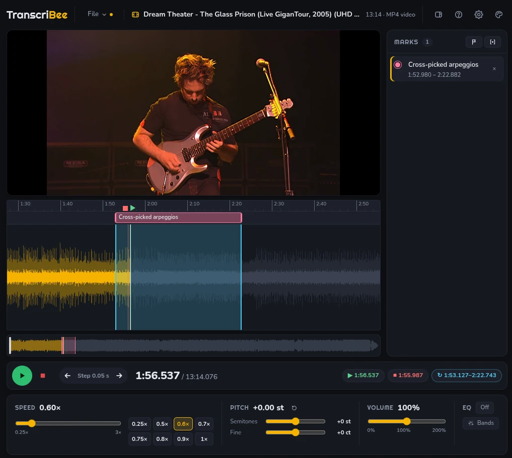

<p align="center"></p>

# EarBee

A desktop player for transcribing music by ear. Open a song or a video, slow it down without changing the pitch (or shift the pitch without changing the speed), loop a passage, and step through it with the keyboard. For Windows, macOS and Linux; free and open source (MIT).



## Download

Get the latest version from the [releases page](https://github.com/wiktor-rocks/earbee/releases/latest), or from [the website](https://earbee.org/).

- **Windows:** `EarBee-…-win-x64.exe`, a portable app: nothing to install. Windows may warn about an unrecognised app the first time; choose **More info**, then **Run anyway**.
- **macOS:** `EarBee-…-mac-arm64.dmg` (Apple Silicon) or `…-mac-x64.dmg` (Intel). Drag it to Applications. It isn't signed by Apple, so the first time, right-click it and choose **Open**. On recent macOS: try to open it, then go to System Settings › Privacy & Security and choose **Open Anyway**. _The macOS builds haven't been tried on a Mac yet; please [report](https://github.com/wiktor-rocks/earbee/issues) how they do._
- **Linux:** `EarBee-…-linux-x86_64.AppImage`. Make it executable (`chmod +x EarBee-*.AppImage`) and run it.

## What it does

- **Slow it down, or shift the pitch,** without the other changing: speed from 0.25× to 3×, pitch in semitones and cents.
- **Loop the hard part:** Shift+drag across the waveform, or, once the beats are found, loop the bar you're in (`\`), double or halve it (`=` / `-`), and move it on phrase by phrase (Shift+`]` / Shift+`[`). Loop edges and marks snap to the beats.
- **Mark it:** points and named regions on the track, with a list beside it.
- **Step through it from the keyboard:** short steps back and forward, Space replays from where you started listening, and Enter from where it last stopped. Press **?** in the app for every key.
- **Find the beats** (B): a beat-tracking model marks every beat and the first of each bar on the waveform, shows the tempo, and lets ← / → step by beat or by bar. A click on each beat (Shift+B) checks them by ear.
- **Videos too,** in sync at any speed; in their own window if you like.
- **Save your session** (marks, loop, speed and EQ) in a `.ebee` project file.
- **Open from YouTube:** paste a link or search, and it opens once downloaded (only download what you have the rights to).
- **EQ, volume up to 200 %, 17 colour themes,** and long files (an hour or two) open in seconds.
- **Works offline;** only downloading needs the internet.

## Build from source

With [Node.js](https://nodejs.org) 22 or newer:

```sh
npm install
npm start            # run it
npm run build:linux  # or build:win, build:mac: the app for your system, in dist/
```

## Licence

MIT: see [LICENSE](LICENSE). EarBee is built on Signalsmith Stretch, Mediabunny, wavesurfer.js, the Beat This! beat tracker, ONNX Runtime, Electron and the Righteous and Nunito fonts, each under its own licence: see [THIRD_PARTY_NOTICES.md](THIRD_PARTY_NOTICES.md).

# Development

**Maintaining it** (the branches, trying an idea on its own `exp/` branch, pulling and pushing, putting out a new version, when CI fails): see [docs/maintaining.md](docs/maintaining.md). AI assistants: [AGENTS.md](AGENTS.md) has the short version, and points to the exact procedures there.

## Requirements

- **Node.js** 22 or newer, and npm.
- **For the tests:** `ffmpeg` with libvpx and libopus (to generate the test media), and a display server. The test windows are invisible, but Electron still needs X11 or Wayland.
- **For `scripts/make-images.py`:** Python 3 with Pillow.
- **For `scripts/export-beat-model.py`** (only to export the beat model again): Python 3 with PyTorch and Beat This!; the script lists the packages.

## Commands

| Command                                           | What it does                                                                                                                                                                                      |
| ------------------------------------------------- | ------------------------------------------------------------------------------------------------------------------------------------------------------------------------------------------------- |
| `npm install`                                     | Install dependencies                                                                                                                                                                              |
| `npm start`                                       | Run the app (reloads on file changes)                                                                                                                                                             |
| `npm run start:gpu-info` / `start:no-gpu`         | Run with GPU diagnostics / with software rendering                                                                                                                                                |
| `npm test`                                        | Unit tests, then end-to-end tests (`tests/run.cjs`), then a smoke test of the real app (`tests/smoke.cjs`)                                                                                        |
| `npm run test:unit`                               | Unit tests only: plain Node, about a second                                                                                                                                                       |
| `TB_TOPICS=02,10 npx electron tests/run.cjs`      | Only some end-to-end topics (by number); later topics may need what earlier ones loaded                                                                                                           |
| `npm run check`                                   | Formatting (Prettier), lint (ESLint, including the import layering in `src/`) and type check (TypeScript on JSDoc)                                                                                |
| `npm run diagnose:loading`                        | Linux: measure loading of long files (10 min – 2 h) and write raw results to `tests/output/diagnostics/`; see `docs/diagnostics/long-file-loading.md`                                             |
| `npm run format`                                  | Format all files                                                                                                                                                                                  |
| `npm run build:dir`                               | Unpacked Linux build in `dist/linux-unpacked`                                                                                                                                                     |
| `npm run build:linux` / `build:win` / `build:mac` | Linux AppImage / Windows portable `.exe` / macOS `.dmg` for Apple Silicon and Intel (on a Mac; signed ad hoc), in `dist/`. Releases are built by `.github/workflows/release.yml` on a version tag |

To test a packaged build:

```sh
npm run build:dir
TB_APP_PATH=$PWD/dist/linux-unpacked/resources/app.asar \
TB_APP_BINARY=$PWD/dist/linux-unpacked/earbee npm test
```

## Files

```
electron/          The main process (CommonJS, Node)
  main.js            window, security, wiring
  windows.js         remembers a window's size and position; the splash shown
                     while the app starts; allows the video window (the one
                     other window)
  splash.*           the splash window's page
  prefs-store.js     keeps the settings (prefs.json): checks, saves, the folder
                     picker; the colour theme, applied before the page shows
  downloader.js      downloading links, and searching by keywords, with yt-dlp
  media-files.js     serves downloaded files (or a slice of one) to the page by private URL
  project-files.js   reads and writes project files (.ebee); the close guard
  system.js          available memory; recovering from a crashed page
  beat-model.js      runs the beat model for the page, in a utility process
                     (beat-model-process.js) on the native ONNX Runtime
  preload.js         the page's bridge to the main process (window.earbee)
src/               The page (ES modules, no build step), in layers:
  core/              pure helpers, no DOM (unit-tested); media.js: media files,
                     the memory check, waveform levels, decoding in parts;
                     beats.js, beat-this.js, melspec.js, resample.js, fft.js:
                     finding the beats
  themes/            colour themes: palettes.js (every theme) and the logic
  search/            searching: the sites (sources.js) and what a result is
  prefs/             settings: the sections (index.js) and the field types
  marks/             marks: what one is, the saved form, the store
  project/           project files: the header, its version, the media
  config.js          every tunable number
  audio/             engine.js (Web Audio + Signalsmith), transport.js,
                     decoder.js + decode-worker.js (parallel decoding),
                     beat-worker.js (the beat model's input, and the simple
                     beat finder), open-track.js (shared by the workers)
  video/             view.js (the picture), proxy.js (its low-res copy for
                     dragging), proxy-plan.js (where the proxy builds next)
  waveform.js        WaveSurfer: zoom, the loop region; its view (zoom,
                     scroll) for the lanes. waveform-draw.js draws it
                     (shaped by core/waveshape.js)
  timeline.js        the lanes above the waveform: ruler (start/stop points),
                     marks lane, guide lines; follows the waveform's view
  context.js         settings, the track's marks, the shared components (`player`)
  ui/                dom.js, controls.js, shortcuts.js, theme.js, prefs.js,
                     pref-fields.js, menu.js (popover menus), storage.js
                     (browser storage), toast.js (notifications)
  features/          playback.js (and the A–B loop), beats.js (finding the
                     beats, the beat click), marks.js, open-file.js,
                     download.js (and search), settings.js (and the theme
                     menu), file-menu.js, layout.js, big-video.js,
                     project/ (index.js: save and open; sections.js: what is saved),
                     video-window/ (the video in its own window; self-contained)
  app.js             entry point: creates and wires everything
  vendor/            Signalsmith Stretch, patched (see its README.md)
  package.json       just "type": "module", so the main process can require()
                     the shared modules (search/, prefs/, project/)
index.html         The page: welcome screen, loading screen, player
style.css          All styles; colour and font tokens at the top
assets/            Logo and icons (generated from earbee-source.png
                   by scripts/make-images.py)
models/            beat-this-small.onnx: the beat model (Beat This!, MIT)
scripts/           make-images.py; export-beat-model.py (the beat model and
                   its test data, from the Python original)
docs/              maintaining.md: day-to-day git, releases, CI;
                   blog.md: the website and its blog;
                   diagnostics/: how long files load, measured
site/              The website, earbee.org: the landing page and the blog,
                   built with Eleventy (its own package.json; see docs/blog.md)
.github/           workflows/pages.yml: builds site/ and publishes it from main
tests/
  unit/              node:test unit tests (core, transport, decoding parts,
                     downloader, media files, system, themes, prefs, marks,
                     project files, search, the waveform's drawing and
                     shaping, the video proxy's plan)
  run.cjs            end-to-end runner: e2e/harness.cjs plus topic files
  e2e/               01-static-ui.cjs … 19-big-video.cjs
  smoke.cjs          the real app: security, window state, the bridge
  preload.cjs        page instrumentation for the e2e tests
  fake-yt-dlp.cjs    stands in for yt-dlp, so downloads test offline
  launch.cjs, make-fixtures.sh
  diagnostics/       measuring long-file loading (npm run diagnose:loading)
CHANGELOG.md       What changed, why, how and where, newest first
```

**Start with the comment at the top of `src/app.js`.** It maps how the parts fit together (engine, transport, waveform, video, UI), lists the files and their layers, and says where to make common changes: speed presets, EQ bands, step sizes, shortcuts, colours, new features.

**Layers.** In `src/`, a file only imports from the layers above it: `core`, `themes`, `search` → `prefs`, `marks`, `project` → `config` → `audio` / `video` / `waveform` / `timeline` → `context` → `ui` → `features` → `app.js` (the zones are in `eslint.config.js`). `npm run lint` fails on an import that goes the other way, or on an import cycle. So `core/`, `audio/transport.js` and the rest of the lower layers stay free of the UI, and can be unit-tested in plain Node.

**Adding a setting.** Settings are declared in `src/prefs/index.js`, one `defineSection()` per section (a tab in the dialog). Add a field to its section: its `key`, `type` (`choice`, `boolean`, `number` or `folder`), `label`, optional `help` and `default`. The Settings dialog shows it, and the main process checks and saves it in `prefs.json`. The page reads it with `getPrefs("section")` and follows changes with `onPrefsChange` (`src/ui/prefs.js`); the main process uses `store.get` and `store.onChange` (`electron/prefs-store.js`). A new section is another `defineSection()` there, listed in `SECTIONS`. The formats are described at the top of `src/prefs/fields.js`.

**Marks.** A mark is `{ id, start, end, label, color }` (`end: null` for a point), described in `src/marks/index.js` along with its saved form, `{ version: 1, marks: [...] }`. The store (`createMarks`, same file) lives in `context.js` and is changed through the actions in `src/features/marks.js`.

**Project files (.ebee).** A project is a JSON header, optionally followed by a NUL byte and the media's bytes (when the media is inside). The header is `{ format, version, savedWith, media, sections }`, described in `src/project/format.js`. **To save something new, add a section** to `SECTIONS` in `src/features/project/sections.js`. A section has an `id`, its own `version`, `capture()` (its saved form), `restore(data, { duration })` (check and clamp: the data comes from a file), and `dirties` (whether changing it counts as an unsaved change). Nothing else needs to change: saving, opening and spotting unsaved changes all go through the list. When a section's form changes, bump its `version` and teach `restore()` to read the old one. Older apps skip a section they don't know, and a section saved by a newer app is skipped with a notice. The main process (`electron/project-files.js`) writes the file to a temporary file and renames it into place, and serves media that's inside a project as a slice of it (`media-files.js`). The page names its media only by the private URL it was given, never by a path.

**Adding a colour theme.** In `src/themes/palettes.js`, copy a theme (for example `nord`), give it a new `id`, `name`, `scheme` (`"dark"` or `"light"`) and colours for each role, then add it to `THEMES` at the bottom of that file. The roles are listed, with what each colours, in `ROLES` in `src/themes/index.js`. `npm run test:unit` checks that the theme defines every role and that its text, accent, loop and error colours have enough contrast. It names any pair that fails.

**Record every change in [CHANGELOG.md](CHANGELOG.md):** what, why, how and where.
